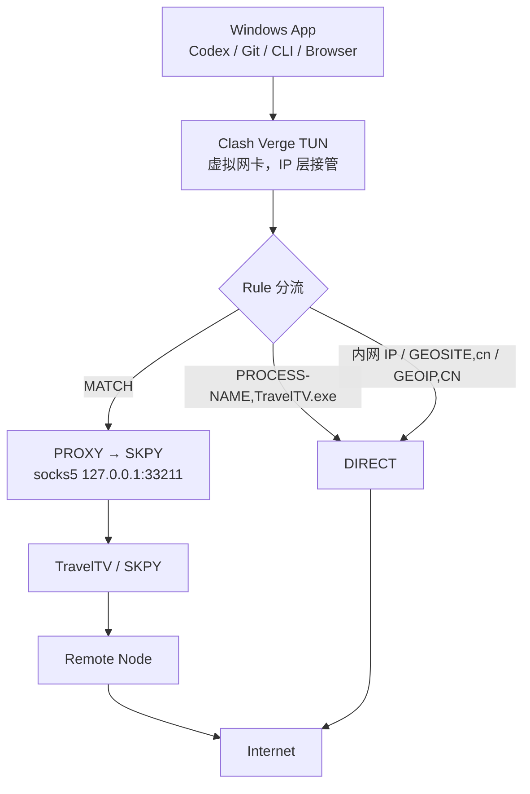

# Clash Verge TUN + 本地 SOCKS5：Windows 代理稳定方案

> Use Clash Verge TUN as a Windows traffic interception layer and forward selected traffic to an existing local SOCKS5 proxy, while keeping the upstream proxy process itself on DIRECT to avoid routing loops.

把任意"只提供本地 SOCKS5 端口"的上游客户端（本文以 TravelTV / SKPY 为例，`127.0.0.1:33211`）接到 Clash Verge Rev 的 TUN 上，让**不遵守系统代理**的程序（Codex、Git、各类 CLI）也能被正确接管，并顺手消掉 `TLS reset` / `connection reset` / `workspace routing discovery timed out` 这类问题。

- 环境：Windows 10 / 11，PowerShell 5.1+，Clash Verge Rev（内核 mihomo）
- 上游：任何提供本地 SOCKS5 端口的客户端都可替换，不限于 TravelTV
- 关键点：**上游进程必须 DIRECT**，否则会形成代理回环

---

## 一、问题背景

### 典型症状

```
TLS reset
connection reset by peer
error sending request for url (...)
workspace routing discovery timed out
```

共同特征：**浏览器能用，但 Codex / Git / CLI 不稳定**，甚至完全连不上。

### 原因：系统代理是"协作式"的

Windows 的"系统代理"（设置 → 网络和 Internet → 代理，底层是 WinINET）本质是一份**被动的配置**，它不会拦截任何流量。只有**主动去读这份配置**的程序才会走代理：

| 程序类型 | 是否读系统代理 |
| --- | --- |
| 浏览器（Chrome / Edge）、部分 Electron 应用 | 读，所以正常 |
| 多数 Rust / Go 写的 CLI（含 Codex 类工具） | **不读**，只认 `HTTP_PROXY` / `HTTPS_PROXY` 环境变量 |
| Git（部分后端）、npm 的部分场景 | 视配置而定，容易漏 |

于是会出现两种典型的坏情况：

1. **你以为全局代理了，其实没代理**：开着系统代理，CLI 仍在直连 → 目标不可达或被中间设备 RST → `TLS reset`、`connection reset`。
2. **手动设了环境变量，链路反而更脆**：`HTTP_PROXY` 指向一个端口/协议不对的代理，或者 `socks5://` 与 `socks5h://` 的 DNS 解析位置不同，导致名字解析失败；也可能环境变量被之前会话残留的旧值污染 → 报错信息看起来像网络问题，其实是配置问题。

`workspace routing discovery timed out` 属于第 2 类：这类工具在启动时会并发探测多个域名/长连接，只要其中一条路径（DNS 或 TCP）被重置或走错出口，整体就超时。

### TUN 的不同

TUN 模式在 Windows 网络栈上创建一块虚拟网卡，在 **IP 层**接管流量。应用完全不需要知道代理的存在——它照常 `connect()`，数据包被 TUN 收走交给 Clash，由 Clash 按规则决定直连还是转给上游 SOCKS5。

所以 TUN 对"不配合的程序"是**强制生效**的，这也是它比系统代理可靠的根本原因。

---

## 二、架构图



ASCII 版：

```
Windows App
     |
     v
Clash Verge TUN
     |
     v
   Rule
  +---------------------------+
  | CN / 内网  -> DIRECT       |
  | TravelTV.exe -> DIRECT    |
  | Other      -> SOCKS5      |
  +---------------------------+
     |
     v
127.0.0.1:33211   (本地 SOCKS5)
     |
     v
TravelTV / SKPY
     |
     v
Remote Node
     |
     v
Internet
```

### 必须排除的回环

TravelTV 自己要连远端节点，如果它的流量也被 TUN 收走再转回 `127.0.0.1:33211`，就形成闭环：


```
TravelTV → Clash → TravelTV → Clash → ...
```

结果通常是：TravelTV 频繁掉线、CPU 升高、流量卡死，甚至整个代理链断掉。

因此规则里必须有、且**优先级要足够高**：

```
PROCESS-NAME,TravelTV.exe,DIRECT
```

---

## 三、安装和配置流程

### 1. 安装 TravelTV / SKPY

按官方方式安装并登录。

### 2. 安装 Clash Verge Rev

从官方仓库发布页下载 Windows 版本（TUN 需要管理员权限，首次开启时会请求提权）。

### 3. 在 TravelTV 中连接一个可用节点

节点能否用，后面第四节的第二步会验证。

### 4. 确认本地 SOCKS5 端口

在 TravelTV 设置里找到本地代理端口，本方案假定为：

```
127.0.0.1:33211
```

> 不同客户端、不同版本的默认端口不一样（常见 1080 / 7890 / 33210 / 33211 等）。**以你客户端里实际显示的端口为准**，把下面配置中的 `port` 改成对应值。

### 5. 导入 Clash 配置

在 Clash Verge Rev 的「订阅 / Profiles」页新建一个**本地（Local）配置**，把下面的 YAML 粘贴进去并启用。

```yaml
mixed-port: 7897
mode: rule
log-level: info
ipv6: false

proxies:
  - name: SKPY
    type: socks5
    server: 127.0.0.1
    port: 33211

proxy-groups:
  - name: PROXY
    type: select
    proxies:
      - SKPY

rules:
  - PROCESS-NAME,TravelTV.exe,DIRECT

  - IP-CIDR,127.0.0.0/8,DIRECT,no-resolve
  - IP-CIDR,10.0.0.0/8,DIRECT,no-resolve
  - IP-CIDR,172.16.0.0/12,DIRECT,no-resolve
  - IP-CIDR,192.168.0.0/16,DIRECT,no-resolve

  - GEOSITE,cn,DIRECT
  - GEOIP,CN,DIRECT,no-resolve

  - MATCH,PROXY
```

规则顺序说明（Clash 自上而下匹配，命中即停）：

1. `PROCESS-NAME,TravelTV.exe,DIRECT` —— 放最前面，确保上游进程永不被接管，杜绝回环。
2. 内网 / 回环网段 DIRECT —— 避免本机服务、局域网共享被绕到境外。
3. `GEOSITE,cn` + `GEOIP,CN` —— 国内流量直连，降低延迟也减少无谓出站。
4. `MATCH,PROXY` —— 兜底：其余全部走本地 SOCKS5。

### 6. Clash 设置

在「设置 / Settings」页确认：

| 项 | 值 |
| --- | --- |
| 模式（Mode） | **Rule** |
| 系统代理（System Proxy） | **OFF** |
| TUN 模式（TUN Mode） | **ON** |

### 7. 关闭 Windows 手动代理

设置 → 网络和 Internet → 代理 → 「使用代理服务器」**关闭**。

TUN 已接管流量，再叠一层手动代理只会让部分应用走错路径或二次代理。

### 8. 不要再给 Codex 单独设置代理环境变量

删掉 `HTTP_PROXY` / `HTTPS_PROXY` / `ALL_PROXY`（见第六节第四层）。TUN 之后不需要这些，留着反而是最常见的坑。

---

## 四、验证命令

以下命令在 **PowerShell** 中执行。

> PowerShell 5.1 里 `curl` 是 `Invoke-WebRequest` 的别名，行为完全不同。**必须写 `curl.exe`**。

### 第一步：本地 SOCKS 端口是否在监听

```powershell
Test-NetConnection 127.0.0.1 -Port 33211
```

期望输出包含：

```
TcpTestSucceeded : True
```

`False` → TravelTV 没有正常提供 SOCKS，先解决它，不要动 Clash。

### 第二步：绕过 Clash，直接测上游 SOCKS

```powershell
curl.exe --max-time 15 --proxy socks5h://127.0.0.1:33211 https://ip.sb
```

成功返回一个公网 IP，说明 **TravelTV / 节点 / 本地 SOCKS 这一段正常**。

> 用 `socks5h://` 而不是 `socks5://`：让 DNS 也在上游解析，避免本地 DNS 被污染导致"看起来是代理坏了"。

### 第三步：开启 Clash TUN 后，测整条链路

确保 TravelTV 正在连接节点、Clash 的 TUN 已开启，然后：

```powershell
curl.exe --max-time 15 https://ip.sb
```

如果这里也能返回代理出口 IP，说明下面这条链路通了：

```
Windows → Clash TUN → SOCKS5 127.0.0.1:33211 → TravelTV → 节点 → Internet
```

注意：第三步返回的 IP 应该和第二步**一致或属于同一出口**。如果返回的是你本机真实公网 IP，说明流量没被接管（TUN 没生效，或命中了 DIRECT 规则）。

### 第四步：国内直连

```powershell
curl.exe -I --max-time 10 https://www.baidu.com
```

期望返回 `HTTP/1.1 200 OK` 之类的响应头。国内站点走 DIRECT，即使上游节点抖了，这一步也应该稳住。

---

## 五、日常使用流程

以后每次开机只需要：

1. 打开 TravelTV，连接一个可用节点
2. 打开 Clash Verge
3. 确认三项设置：**Rule** / **System Proxy OFF** / **TUN ON**
4. 正常使用电脑，不用管具体程序走没走代理

**换节点时**：只在 TravelTV 里切换。Clash 不需要改动——它只认 `127.0.0.1:33211` 这一个固定入口，节点换了它无感。

---

## 六、故障排查流程

严格按层往上查，**前一层没过就不要碰后一层**，否则容易同时改坏多个环节。

### 第一层：本地 SOCKS 端口

```powershell
Test-NetConnection 127.0.0.1 -Port 33211
```

`TcpTestSucceeded : False`

→ TravelTV 没有正常提供 SOCKS。检查客户端是否启动、是否已连接节点、端口设置是否被改过。**此时不要折腾 Clash 或 Codex。**

### 第二层：上游节点

```powershell
curl.exe --max-time 15 --proxy socks5h://127.0.0.1:33211 https://ip.sb
```

超时或失败

→ TravelTV 当前节点或底层网络有问题。**优先换节点**，其次检查客户端本身的连通性。这一层没过时，改 Clash 是白改。

### 第三层：Clash TUN

如果第二层成功，但 Clash TUN 开启后这一条失败：

```powershell
curl.exe --max-time 15 https://ip.sb
```

→ 问题在 Clash 这一侧。逐项检查：

- 模式是否为 **Rule**
- **TUN 是否为 ON**
- **System Proxy 是否为 OFF**
- 当前启用的配置是不是你改过的那份（多配置时最容易踩）
- 规则里是否存在 `PROCESS-NAME,TravelTV.exe,DIRECT`
- 端口是否和你上游客户端实际端口一致

也可以看 Clash 的「连接 / Connections」页：请求有没有出现、命中的是哪条规则、走的是 DIRECT 还是 PROXY。

### 第四层：只有 Codex（或某个 CLI）不正常

浏览器和 `curl.exe` 都正常，唯独某个 CLI 报错 → 基本可以断定是**旧代理环境变量残留**。

查看：

```powershell
Get-ChildItem Env:HTTP_PROXY,Env:HTTPS_PROXY,Env:ALL_PROXY -ErrorAction SilentlyContinue
```

清理：

```powershell
Remove-Item Env:HTTP_PROXY -ErrorAction SilentlyContinue
Remove-Item Env:HTTPS_PROXY -ErrorAction SilentlyContinue
Remove-Item Env:ALL_PROXY -ErrorAction SilentlyContinue
```

然后**重新启动 Codex**（环境变量只在新进程里才干净）。

> 这类变量可能来自系统级设置（`setx` 写的会持久化）或某个 shell 启动脚本。当前会话清了还复现，就去「系统属性 → 环境变量」里删掉持久化的那几条。

---

## 七、故障判断表

| 现象 | 最可能的原因 | 下一步动作 |
| --- | --- | --- |
| `Test-NetConnection 127.0.0.1 -Port 33211` 返回 `False` | 上游客户端没启动 / 没连节点 / 端口被改 | 在 TravelTV 里连接节点，并核对其本地 SOCKS 端口 |
| `--proxy socks5h://127.0.0.1:33211` 超时或失败 | 当前节点不可用，或本机到节点的网络有问题 | 换节点重试；此时不要动 Clash 和 Codex |
| SOCKS curl 成功，但普通 `curl.exe` 失败 | Clash TUN 未生效 / 模式不是 Rule / 当前配置不是改过的那份 | 检查 TUN ON、Rule、System Proxy OFF、规则文件是否为当前启用项 |
| 普通 curl 返回的是本机真实公网 IP | 流量走了 DIRECT，没被 TUN 接管 | 检查是否命中 DIRECT 规则、TUN 是否真的开启 |
| 国内网站（baidu）失败，但国外正常 | `GEOSITE,cn` / `GEOIP,CN` 规则失效或 DNS 异常 | 确认规则顺序未被覆盖，重启内核后重试 |
| 开启 Clash TUN 后 TravelTV 掉线 / 断流 / CPU 升高 | 代理回环：TravelTV 流量被 TUN 收回 SOCKS | 确认 `PROCESS-NAME,TravelTV.exe,DIRECT` 存在且在所有规则之前 |
| 浏览器、curl 都正常，只有 Codex / 单个 CLI 不正常 | 旧代理环境变量残留（`HTTP_PROXY` 等） | 按第四层清理环境变量并重启该程序 |
| `workspace routing discovery timed out` | 工具启动时并发探测多条路径，其中一条被重置或走错出口 | 先跑一、二、三层确认链路；再清环境变量；最后才怀疑该工具自身配置 |
| 换节点后全部断掉 | 上游客户端重启后端口变化，或节点本身不可用 | 重新核对本地 SOCKS 端口，按第一、二层顺序复查 |

---

## 八、原理解释

### 传统系统代理

```
App → HTTP/SOCKS Proxy → Internet
```

应用必须**主动支持并读取**代理设置。谁来读、读哪个变量，各程序做法不同：浏览器读 WinINET，Rust/Go CLI 通常只读环境变量，还有一些什么都不读。这就是"浏览器能用、CLI 不能用"的根源。

### TUN

```
App → Windows Network Stack → TUN → Clash → SOCKS5 → 上游 → Internet
```

应用把数据包交给操作系统，操作系统交给 Clash 的虚拟网卡。**应用视角里根本没有代理这回事**，因此不存在"程序不配合"的问题。

### 这不是把 SOCKS5 变成 VPN

需要明确一点：这里并没有改变 SOCKS5 的协议性质。真正做的是：

1. 用 TUN 在 IP 层**接管**系统流量；
2. Clash 按规则决定每一条连接的去向；
3. 需要代理的连接被**转交**给本地 SOCKS5 出口。

也就是说，SOCKS5 仍然是 SOCKS5，只是获得它的方式从"应用自己配置"变成了"系统层统一转发"。对应用的体验接近 VPN：全局生效、无需逐个配置。

代价也来自这里——所有流量都会经过 TUN，所以**分流规则的正确性**变得更重要，尤其是排除上游进程自身的回环规则。

---

## 九、注意事项

- **不要同时开启 Clash 的 System Proxy 和 TUN**，除非你有明确的需求和验证过的理由。两层叠加会让部分应用走错路径。
- **`TravelTV.exe` 必须 DIRECT**，且规则要放在最前面。这是防回环的关键，漏了会表现为"代理莫名掉线"。
- **Windows 手动代理必须关闭**。
- 不要把订阅链接、账号、密码、token、cookie 写进仓库或截图里。
- 不要在文档里写任何个人隐私信息（真实 IP、本机主机名、用户名、邮箱等）。
- 不要把某个具体用户的出口 IP 当作固定配置写进规则。
- **`127.0.0.1:33211` 只是一个示例端口**。不同客户端端口不同，请以本机实际值为准，`socks5` 的 `server` / `port` 与 `Test-NetConnection` 里的端口要保持一致。
- **TravelTV / SKPY 只是本案例**。本方案对任何提供本地 SOCKS5 端口的客户端都成立：把 `proxies` 里的 `server` / `port` 换掉即可，甚至可以直接写多个上游做 `url-test` / `fallback` 分组。
- 上游若支持 UDP，可在 `proxies` 项里加 `udp: true`；不需要就别加。

---

## 十、仓库结构

```
clash-tun-local-socks-guide/
├── README.md    # 本文档
└── LICENSE      # MIT License
```

## 十一、许可

[MIT License](LICENSE)
